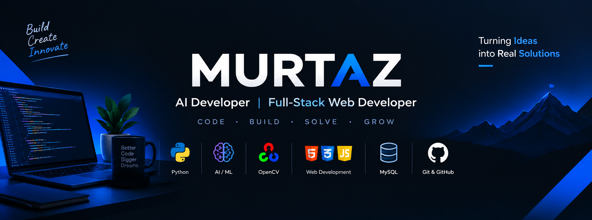

  

  <h1>Murtaz</h1>

  

    
  

  

    I build practical software, explore intelligent systems, and learn by creating real projects.
  

  

    <a href="https://github.com/murtaz-ai">GitHub</a> ·
    <a href="#about">About</a> ·
    <a href="#skills">Skills</a> ·
    <a href="#projects">Projects</a> ·
    <a href="#currently-learning">Currently Learning</a> ·
    <a href="#contact">Contact</a>
  

---

## About

I'm a **BS Artificial Intelligence student** and **Full-Stack Web Developer** interested in building useful applications and understanding how intelligent systems work.

I enjoy learning through hands-on projects, solving programming problems, and turning ideas into working software.

- 🎓 Studying Artificial Intelligence
- 💻 Building web applications and Python projects
- 👁️ Exploring computer vision with OpenCV
- 🤖 Interested in robotics, automation, and intelligent systems
- 📚 Continuously improving my programming and problem-solving skills

## Skills & Technologies

**Programming**

  

**Web Development & Databases**

  

**Data & Computer Vision**

  

**Development Tools**

  

My current focus is strengthening Python, practicing image processing, and building a solid foundation in machine learning.

## Featured Projects

### 🌦️ Weather CLI Application

A Python command-line application that retrieves weather information through WeatherAPI. The project focuses on API integration, handling user input, and presenting weather data.

**Technologies:** Python · Requests · REST API · Matplotlib

[View Repository →](https://github.com/murtaz-ai/weather-cli-app)

---

### 💰 Expense Tracker

A Python application for recording and managing expenses with persistent CSV storage.

**Features:** Add expenses · View records · Search · Delete · Calculate totals

**Technologies:** Python · CSV · File Handling

[View Repository →](https://github.com/murtaz-ai/expense-tracker-python)

---

### 👁️ Computer Vision Experiments

Hands-on practice with OpenCV and image processing, including thresholding, filtering, edge detection, contours, and webcam input.

**Status:** Learning and experimentation

### 🤖 Robotics & Intelligent Systems

Exploring robotics concepts, microcontrollers, sensors, automation, and the connection between software and hardware.

**Status:** Ongoing learning and exploration

## Currently Learning

- **Python:** Building practical applications and improving code structure.
- **Machine Learning:** Learning the fundamentals, data preparation, regression, classification, and model evaluation.
- **Computer Vision:** Practicing image processing and webcam-based projects with OpenCV.
- **Artificial Intelligence:** Studying algorithms and computational problem-solving.
- **Robotics:** Exploring embedded systems, sensors, and automation.
- **Full-Stack Development:** Improving frontend, backend, database, and API integration skills.

## GitHub Activity

  

  

## Contact & Collaboration

I'm interested in connecting with developers and collaborating on practical software, AI, computer vision, and robotics projects.

  

  

  **Build · Learn · Grow**

